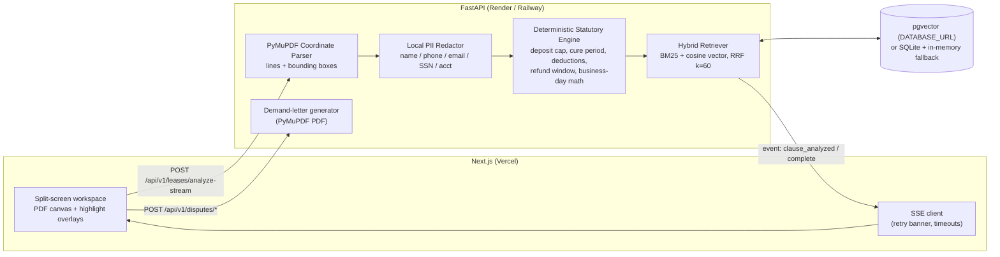

# LeaseGuard

**Zero-login lease auditor and security-deposit dispute shield for Georgia renters.**

Georgia's Safe at Home Act (HB 404) and O.C.G.A. Title 44, Chapter 7 cap deposits at two months' rent, guarantee a 3-day right to cure and a habitable (cooled) home, but student leases routinely contradict them and few renters can spot it. LeaseGuard reads a lease PDF, flags every clause that conflicts with the statutes (with the exact quote and its location on the page), writes a ready-to-send counter-clause, and generates a formal demand letter with treble-damages math when a landlord misses the 3-business-day / 30-day deposit deadlines.

| | |
| :-- | :-- |
| Live demo | `https://<your-app>.vercel.app` (deploy steps below) |
| Stack | Next.js 14 · TypeScript · Tailwind · FastAPI · PyMuPDF · scikit-learn · SQLite / PostgreSQL + pgvector |
| Guarantees | every flag carries a verbatim quote that is an exact substring of the PDF page text, plus an in-bounds `[x0,y0,x1,y1]` box; all money and date math is deterministic Python, never an LLM |

## Architecture



Pipeline order for each lease: **parse → redact PII locally → apply deterministic rules → ground each finding with hybrid retrieval → verify quote & box → stream over SSE**. If `DATABASE_URL` is unset or unreachable the API seeds SQLite and an in-memory index from `packages/sample-data/georgia_statutes.json` at startup, so a cold-started demo never crashes (`GET /api/v1/health` reports `storage_mode`).

## Quickstart (local)

```bash
python scripts/dev.py --install
```

Then open <http://localhost:3000>. The sample Athens student lease is audited automatically: 5 risk cards and 5 highlights, no login. Drop `--install` on later runs.

Run the checks:

```bash
cd apps/api && pytest -v                                   # 21 backend tests
cd apps/web && npm run lint && npx tsc --noEmit && npm run build
cd apps/web && npx playwright install chromium && npx playwright test   # E2E against the real stack
```

## Deploy (about 5 minutes)

**1. Push to GitHub**

```bash
git init && git add . && git commit -m "LeaseGuard" && git branch -M main
git remote add origin https://github.com/<you>/leaseguard.git && git push -u origin main
```

**2. API on Render** (or Railway)

- Render: *New → Blueprint →* pick the repo. `render.yaml` builds `apps/api/Dockerfile` and health-checks `/api/v1/health`.
- Railway: *New Project → Deploy from GitHub*. `railway.json` selects the same Dockerfile and health check.
- Note the public URL, e.g. `https://leaseguard-api.onrender.com`.

**3. Web on Vercel**

- *Add New → Project →* import the repo, set **Root Directory** to `apps/web`.
- Add the environment variable `NEXT_PUBLIC_API_URL=https://leaseguard-api.onrender.com`, then deploy.

**4. Close the loop (CORS)**

- On Render/Railway set `ALLOWED_ORIGINS=https://<your-app>.vercel.app` and redeploy the API. (`*.vercel.app` previews and `localhost:3000` are allowed by default.)
- Optional: set `DATABASE_URL` to a Postgres with the `vector` extension (Neon, Supabase, Railway) to switch `storage_mode` to `pgvector`.

Free-tier APIs sleep when idle; the UI shows a retry banner while the first request wakes the service.

## API

| Route | Purpose |
| :-- | :-- |
| `GET /api/v1/health` | `{status, statutes_loaded, sample_pdf_ready, storage_mode}` |
| `GET/POST /api/v1/leases/analyze-stream` | SSE audit of the sample lease, or an uploaded PDF (multipart `file`) |
| `GET /api/v1/leases/sample`, `POST /api/v1/leases/analyze` | Same audit as plain JSON |
| `POST /api/v1/disputes/evaluate` | 3-business-day inspection, 30-day return, treble-damages eligibility |
| `POST /api/v1/disputes/demand-letter` | Formal demand letter as `application/pdf` |

SSE responses send `Cache-Control: no-cache, no-transform`, `Connection: keep-alive` and `X-Accel-Buffering: no` so proxies do not buffer the stream.

## Statutes enforced

| Rule | Source | Check |
| :-- | :-- | :-- |
| Deposit cap | O.C.G.A. § 44-7-30.1 (HB 404) | deposit > 2 × monthly rent |
| Habitability / cooling | O.C.G.A. § 44-7-13, HB 404 | AC cost shifting or cooling shut-off |
| Right to cure | HB 404 / § 44-7-50 | notice waiver or immediate filing (0-day cure) |
| Damage list, wear and tear | O.C.G.A. § 44-7-33 | flat/automatic deductions; list later than 3 business days |
| Deposit return | O.C.G.A. §§ 44-7-34, 44-7-35 | return window over 30 days; treble damages |

Not legal advice. Statute text in `packages/sample-data/georgia_statutes.json` is a summarised corpus; verify against the current O.C.G.A. before relying on it.
